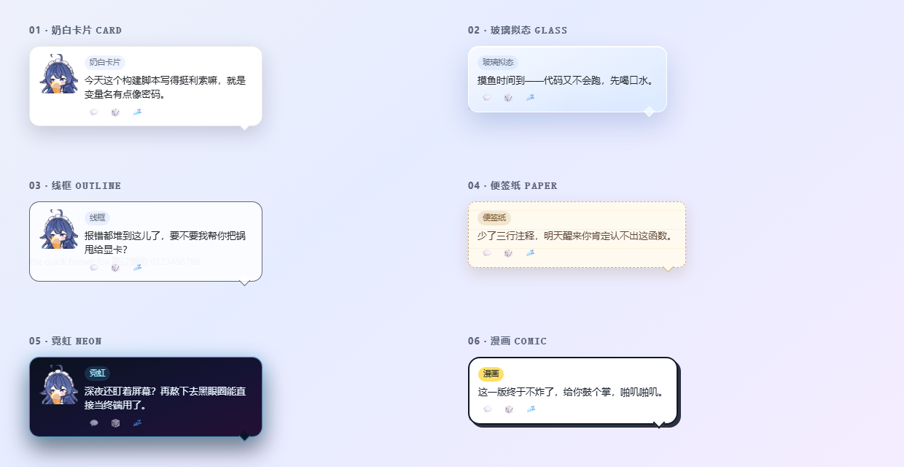
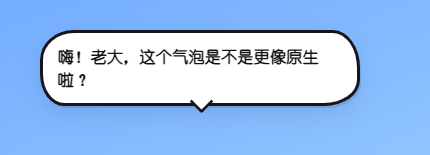

# @local/pet-chatter · 大肥鱼吐槽气泡

大肥鱼会瞄一眼你刚聊完的那一轮，在你的宠物（`[data-nekowhale-pet]`，即表情包插件的大肥鱼）
右上角冒一个气泡，说一句带细节的短评 / 鬼点子 / 温柔吐槽，并用你选的音色念出来。

## 快速上手

- **等它开口**：正常聊天即可；一轮结束、空闲一阵或到催睡时间，它可能冒泡（受频率 / 间隔 / 每小时配额限制）。
- **立刻找它**：**长按桌宠 0.7 秒**，或按 `Alt+Shift+P`。
- **拖一下 / 点一下**：本地随机语音反应，不再等模型；冒泡概率可在设置里调。
- **调整外观**：设置 → 大肥鱼吐槽（或插件页）；外观里可换七款气泡框和四种特效。
- **自检**：`node tools/acceptance.mjs`（29 项，结束时清空队列）。

## 更新记录（摘要）

- **0.8.4**：右侧气泡贴边时**每一行文字仍统一左对齐**，不再出现整段右对齐；打字机仍先用隐藏全文撑满最终行宽/行高再逐字显示。主动短评只使用最近一轮摘要，空闲搭话只讲笑话+关心；自动话术不再吃 `recent`、测试样例句或长期 facts，`/test?internal=1` 也不会污染真实上下文。模型偶尔包在 `<p>...</p>` 里的回复会在解析和聊天落盘前统一剥掉，包括残缺的 `<p`/`</p`；句中/句尾装饰性的上横杠（`￣`/`¯`/`‾`）也会清掉，但不碰 `(￣▽￣)`、`=￣ω￣=` 这类表情内部字符。
- **0.8.3**：打字机气泡先用隐藏全文撑满最终行宽/行高，不再逐字把文字挤成多行或和光标叠在一起；`width:max-content` 先量宽再贴边，右侧不再被压窄；右边界方向在 0.8.4 修正为“贴边但文字左对齐”。
- **0.8.2**：音频失效提示统一为「老大老大，音频失效辣」，随包提示音改用配置的 `zh-CN-XiaoyiNeural` 预合成 MP3，不再拿 Windows/SAPI 的 Huihui 声音冒充；提示音路由 `no-store` 且 URL 带 `?v=xiaoyi-1`，旧 WAV 缓存不会再命中；旧设置里的「主人，音频失效了」自动迁移。
- **0.8.1**：空闲搭话不再被任意后台/主会话的 `runningSessions` 全局拦住；主动短评不再因用户消息超过 10 分钟被 `stale-turn` 丢弃；idle 提示词要求先讲一句短笑话再关心；主动气泡在语音结束/文字显示完后 3 秒自动关闭，hover 和设置面板不再给它延寿，聊天/回复仍可阻止关闭。
- **0.8.0**：空闲阈值最低改为 1 分钟（空闲检查每分钟一次）；气泡显示期间不再触发新气泡（`bubble-active`）；主动气泡新增右上角「↩ 回复这条」，在同一气泡内开聊并携带原话上下文，关闭时释放本次 agent 句柄但保留会话记忆。
- **0.7.0**：加入动作联动软偏向（`actionBiasChance`，未知动作仍 100% 随机）；聊天打开时清空待显示队列；合并旧 9 种情绪到 23 种池；右上角「×」从 18px 增至 24px；新增 SSE 唤醒（轮询仍保留为兜底）；表情搜索追加 25 类情绪同义词标签。
- **0.6.0**：按 23 种情绪 × 3 条 × 点击/拖动两套新增 138 条本地语音，原有 77 条保留；现在点击 103 条、拖动 112 条，共 215 条随包 MP3。拖动选表情不再优先“搞怪”，点击/拖动都按台词情绪配同组表情；23 种为开心、大笑、喜欢、害羞、得意、兴奋、惊讶、疑惑、思考、无语、难过、哭、生气、害怕、疲惫、赞同、拒绝、打招呼、感谢、卖萌、搞怪、嘲讽、安慰（排除道歉/其他）。
- **0.5.2**：拖动也不再强制 `curious`。点击和拖动都交给桌宠本体处理，保留原生的点按/拖拽动作多样性；气泡插件只负责气泡、文字、语音和表情图。
- **0.5.1**：点击不再强制 `happy`。之前每次点击父页面都发 `happy`，还会在气泡显示时再发一次，覆盖了桌宠自己的点按/连击反应，所以看起来永远同一种；现在点击交给桌宠本体处理，点击/拖动气泡显示时也不再覆盖身体动作。
- **0.5.0**：统一气泡架构——主动 / 点击 / 拖动共用**一个 `bubbleGapSeconds` 间隔**，删掉重复的拖动双间隔、拖动概率和点击冷却；长按聊天期间自动/点击/拖动**全部暂停**，关闭聊天后恢复。点击与拖动的台词和音频全部本地化（34 条点击 + 43 条拖动，按 9 种情绪分组，每条都有随包 MP3），约 10ms 返回、约 0.2 秒冒泡；新增点击/拖动冒泡概率，气泡会选同情绪的表情图；拖动会按屏幕位置优先选“恐高/贴底/靠左/靠右”等台词。气泡只在右上角留一个很小的「×」，底部不再有按钮条。
- **0.4.9**：拖动反馈改为本地固定随机语料；修掉「语音接上时气泡又弹一次 / 重新打字」；原生风改成白底粗黑描边 + 加粗幼圆，统一字重
- **0.4.8**：新增第七款「原生风」气泡框（白底、圆角、居中短尾、贴头顶、轻弹出）；新增拖动反馈概率 `dragChance`；拖动反馈改为低思考 + 小输出预算，并把语音与表情图并行；语音设置页显示上次失败原因与熔断时间；用户主动拖动/聊天会穿透熔断再试一次
- **0.4.7**：长按开聊改用**独立、持久、有记忆的 agent**（重启后仍记得聊过什么；上下文到 72% 自动摘要并换新会话；`low` 轻量思考，模型不支持时自动降级）；问候语与回复统一使用设置里的气泡框/特效；回复气泡与语音**同一帧出现**（不再先字后声）；回复直接替换问候语，不再在下面叠旧回复；删除桌宠旁的 💬 把手；拖动桌宠改为「模型 + 语音 + 表情图」反馈，触发间隔/强制间隔可配；Edge 连续失败加 5 分钟熔断，避免每次回复都等重试
- **0.4.6**：长按桌宠 0.7 秒直接开聊（短按行为不变）
- **0.4.5**：`Alt+Shift+P` 快捷开聊；新增一键验收脚本
- **0.4.4**：桌宠反应冷却可调（默认 25 秒）
- **0.4.3**：「最近说过」落盘（重载后仍在）；新增「桌宠反应」开关
- **0.4.2**：聊天回复先出字、语音后台补齐（不再等合成）；新增 `POST /pet-chatter/speak`
- **0.4.1**：桌宠旁边加「聊天把手」💬（左键/右键都能开聊，桌宠本体左键不变）；气泡出现时会让桌宠做对应小动作（鬼点子=想、吐槽=眨眼、安慰=点头、开聊=打招呼）；点一下桌宠它会 `happy`，偶尔回一句「别戳啦，痒」，拖完松手会 `curious` 并吐槽一句（各 25s / 40s 冷却）；人格提示词去 UI 化——不再复述「放在右上角」这类界面词，句子更像朋友随口说话，每次换角度
- **0.4.0**：右键大肥鱼直接开聊（回复带语音）、🎲 再来一句独立响应并 1.5 秒节流、语音只用设定音色（失败改说「音频失效了」，不再降级系统机器人音色）
- **0.3.4**：「预览气泡」每次点击都生效——预览绕过同句去重，并让浏览器立刻替换当前气泡；预览会带上当前未保存的框/特效/位置
- **0.3.3**：气泡特效行为修正——「无」改为瞬显（不再和「柔和」一样）、「活泼」每条气泡都重播星屑与弹跳、「打字机」不再先闪一下全文；reroll 支持 `internal=1`，测试不再占配额、不弹测试气泡；Edge 连续失败时**并行**启用系统语音，网络抖动不再变成「音频失效」
- **0.3.2**：六款可切换气泡框（奶白卡片 / 玻璃拟态 / 线框 / 便签纸 / 霓虹 / 漫画），只换边框和底色，文字、表情与布局不动
- **0.3.1**：语音先合成、后出气泡（每条气泡必有声音；合成全挂时改用随包提示音并说明「音频失效了」）、同句 10 分钟内去重、去掉异步补音频与 60 秒过期丢弃、轮询 5s→2s
- **0.3.0**：长期记忆（`记住：…`）、气泡内短对话（3 轮记忆）、每天催睡 + 安静期、自动深夜、快捷模式、语气化语速、runtime 自检与内存趋势
- **0.2.0**：设置页全参数、6 性格、12 音色、4 特效、贴纸按语气选、引用行、🎲 再来一句
- **0.1.0**：气泡贴宠物右上角、Edge/SAPI 双引擎、频率闸门与队列

## 组成

```
index.js   Host 半：会话事件折叠 → 统一气泡闸门 →（主动调模型 / 点击拖动查本地语音池）→ 队列 → HTTP 路由
           另含长按开聊的持久 agent（摘要记忆 + 72% 自动压缩）与聊天优先暂停
lib/pure.js 无依赖纯函数（时间窗、截断、解析、校验、预设），可单独跑单测
tts.js     语音适配：Edge 神经语音（@andresaya/edge-tts）
client.js  浏览器半：气泡（贴桌宠/跟随拖动/特效）+ 聊天输入 + 设置页
tools/     smoke.mjs（HTTP 端到端）、test-pure.mjs（纯函数单测）、test-voice.mjs（语音链路）、
           controls.mjs（设置页控件矩阵）、stress.mjs（滥用/压力）、health.mjs（只读体检）、
           acceptance.mjs（交付验收）、persona-audit.mjs（人格抽查）
locale/    插件页标题与描述
icon.svg   插件图标
```

生成的语气：`comment` 短评 / `idea` 💡鬼点子 / `roast` 😼吐槽老大 / `comfort` 🥺报错后的安慰；
另外 `idle` 🐋 会在你静默超过 `idleMinutes` 后主动搭话，`bedtime` 🌙 每天到点催睡，
`drag` 是拖动后的即时反应，`chat` 是长按开聊的对话。

## 安装与开关

- 安装位置：profile `desktop` 的 `dsh.profile.bundles` 中有一行 `@local/pet-chatter`，指向本目录（link 安装）
- 改设置：网页侧栏 **设置 → 大肥鱼吐槽**（插件页里也有 schemastery 自动生成的表单）
- 临时关闭：设置页「总开关」，或在 profile 的 `cordis.patch.yml` 里给同 id 行加 `disabled: true`
- 彻底移除：通过插件管理解绑 `@local/pet-chatter`，再删掉本目录与 `$DSH_HOME/pet-chatter/`

数据流：

```
session/event ─► 每会话摘要(user/assistant/tools/耗时) ─► 闸门(概率/间隔/配额/静音时段/有人在线)
      │turn/end(completed 或 error)                          │
      ▼                                                        ▼
  llm.stream(性格 + 种类提示) ──► JSON {text,mood} ──► stickers.pick(mood)（可选小图）
                                                              │
                                                              ▼
                                                    TTS 缓存 mp3/wav ─► 队列(TTL)
                                                              │
                       浏览器 2s 轮询 GET /pet-chatter/pending ◄──┘
```

主动/聊天在入队前合成语音；点击/拖动直接使用随包音频，所以队列里的三种气泡都带可播放音频（除非明确关闭语音概率）。

## 路由

| 方法 | 路径 | 说明 |
|---|---|---|
| GET | `/pet-chatter/pending` | 取走一条气泡；空队列 204。返回的条目一定带好 `audioUrl`（或 `null` 表示设置成静音），不会先出字后补声音 |
| GET | `/pet-chatter/voice/<hash>.mp3\|.wav` | 语音文件，强缓存 |
| GET | `/pet-chatter/alert-voice` | 打包在插件里的「音频失效」提示音，随包分发、永远可播 |
| GET | `/pet-chatter/sticker/<hash>.gif` | 表情小图（从 stickers 服务硬链接过来，避免外域限制） |
| GET/POST | `/pet-chatter/settings` | 读/写设置（写 `$DSH_HOME/pet-chatter/settings.json`，并同步进 profile 的 `cordis.patch.yml`） |
| POST | `/pet-chatter/preset` | 切换快捷模式：`{"name":"quiet"}`，也可 `chatty` / `night` / `default` |
| POST | `/pet-chatter/preview` | 试听一个音色，返回 `{audioUrl, engine}` |
| POST | `/pet-chatter/say` | 直接说一句（不调模型），可带 `speak`/`effects`/`anchor`/`mood` |
| POST | `/pet-chatter/chat` | 长按开聊：走持久 agent，返回**文字 + 语音**（`audioUrl` 与文字同时到）；agent 不可用时自动退回单次调用 |
| POST | `/pet-chatter/chat/status` | 只读：agent 会话 id、轮次、上下文占用、压缩时间、上次错误 |
| POST | `/pet-chatter/chat/compact` | 立即把聊天压缩成摘要并换新会话；`{"force":true}` 可在阈值前强制压缩（设置页按钮/测试用） |
| POST | `/pet-chatter/manual/hello` | 长按瞬间的问候语；返回带当前气泡框/特效/位置/音量的 `item`（不含音频，客户端随后取 `/speak`） |
| POST | `/pet-chatter/drag` | 拖动反馈：本地随机语料 + 随包语音 + 同情绪表情图；受 `bubbleGapSeconds` 约束，不调用模型 |
| POST | `/pet-chatter/click` | 点击反馈：本地随机语料 + 随包语音；受 `clickBubbleChance` / `bubbleGapSeconds` 约束 |
| POST | `/pet-chatter/speak` | 把一段文字合成语音，返回 `{audioUrl}`（问候语与聊天语音都可用） |
| POST | `/pet-chatter/memory` | 查看/清空长期记忆（`{"action":"clear"}`、`{"action":"add","text":"…"}`） |
| POST | `/pet-chatter/reroll` | 「再来一句」：独立生成、直接替换当前气泡，1.5 秒冷却；没有上一轮时也能说 |
| POST | `/pet-chatter/test` | 立刻生成一条（支持 `?personality= &voice= &effects= &tts= &kind=`；`internal=1` 只测不显示） |
| POST | `/pet-chatter/hello` | 浏览器半上报自己挂载了哪些 slot（诊断用） |
| POST | `/pet-chatter/heartbeat` | 浏览器半的心跳（版本、槽位、可见性），供设置页诊断 |
| POST | `/pet-chatter/client-log` | 浏览器半上报气泡生命周期（show/playing/ended/cut/audio-error…），只保留最近 40 条 |

## 配置

优先级：profile 的 `cordis.patch.yml` 同 id 行 **>** `settings.json`（设置页写入） **>** 代码默认值。面板保存时会把它写的那份同步进 profile 行，所以插件页表单和气泡面板看到的数字始终一致；哪边改都立刻生效。

运行期数据都在 `$DSH_HOME/pet-chatter/`：`settings.json`（设置覆盖）、`last-turn.json`（最近一轮摘要，供「再来一句」重启后使用）、`memory.json`（长期记忆）、`history.json`（最近 20 条台词）、`chat-agent.json`（聊天 agent 的会话 id + 压缩后的长期记忆）、`rss-trend.json`（内存趋势）、`voice/`（语音缓存）、`stickers/`（表情硬链接缓存）。JSON 都用「临时文件 + rename」原子写入，进程崩在写入中间也不会留下半个文件。

| 键 | 默认 | 说明 |
|---|---|---|
| `enabled` | true | 总开关 |
| `personality` | balance | balance/tease/clingy/gremlin/zen/hype |
| `address` / `persona` | 老大 / 空 | 称呼 / 追加风格 |
| `ideaChance` / `roastChance` | 0.18 / 0.15 | 鬼点子概率 / 吐槽老大概率（吐槽排在鬼点子之后） |
| `frequency` | normal | rare 0.3 / normal 0.55 / often 0.85 |
| `minGapMinutes` / `maxPerHour` | 3 / 8 | 节奏闸门 |
| `quietHours` | 空 | 例如 `01:00-08:00` |
| `tts` | auto | auto/edge 只用 Edge 神经语音（失败改说音频失效）；sapi 用 Windows 本地语音；off 不出声 |
| `voice` | zh-CN-XiaoyiNeural | 12 个已实测可用的 Edge 音色 |
| `rate` / `pitch` / `volume` | +8% / +15Hz / 0.9 | 语音参数 |
| `voiceChance` | 1 | 语音出现频率：默认 1，每条气泡都有声音；调低才会偶尔只出气泡不出声 |
| `expressive` | true | 按语气微调语速/音高（鬼点子更快更高、安慰更慢更低） |
| `nightAuto` / `nightHours` | false / `01:00-08:00` | 到点自动降频、降音量、关空闲搭话，不改写设置文件 |
| `idleEnabled` / `idleMinutes` | true / 45 | 没人聊时是否主动搭话、静默多少分钟后（最低 1 分钟，每分钟检查一次） |
| `bedtime` | 空 | 每天催睡觉的时间，例如 `23:30`（15 分钟窗口内只触发一次）；留空关闭 |
| `bedtimeQuietMinutes` | 20 | 催睡后安静多少分钟，避免接着唠叨 |
| `effects` | soft | none/soft/lively（星屑 + 弹跳） |
| `bubbleStyle` | card | 气泡框：card 奶白卡片 / glass 玻璃 / outline 线框 / paper 便签 / neon 霓虹 / comic 漫画 / native 原生风（白底黑边、加粗圆体、贴头） |
| `anchor` | pet | pet 贴宠物右上角 / corner 屏幕右下角 |
| `stickerChance` | 0.4 | 自动/预览气泡带表情小图的概率；点击/拖动反馈强制带图，不受它影响 |
| `petReactions` | true | 点一下桌宠时是否用本地语音回应 |
| `clickBubbleChance` | 0.4 | 点击时冒出气泡+语音的概率；没抽中只做桌宠表情反应，不弹气泡 |
| `dragFeedback` | true | 拖到新位置后是否用本地语音回应 |
| `dragBubbleChance` | 0.7 | 拖动松手后冒出气泡+语音的概率；没抽中只做桌宠表情反应 |
| `bubbleGapSeconds` | 15 | 主动 / 点击 / 拖动三种气泡共用的全局间隔；聊天优先，不受它限制 |
| `actionBiasChance` | 0.6 | 已知桌宠动作时，台词偏向对应情绪的概率；未知动作仍 100% 随机 |
| `chatAgent` | true | 长按开聊使用独立、持久、有记忆的 agent（关掉退回单次模型调用） |
| `chatReasoning` | low | 聊天 agent 的思考强度：固定最轻的 `low`，模型不支持时自动省略/降级 |
| `chatCompactPercent` | 72 | 聊天 agent 上下文用到百分之多少时自动摘要并换新会话（40–95） |
| `queueTtlSeconds` | 120 | 条目过期时间 |

## 对其他插件暴露的接口

Host 半 `provide: 'petChatter'`，其它插件可以：

```js
export const inject = ['petChatter'];
// ctx.petChatter.say('老大，构建挂了', { mood: '委屈', speak: true, kind: 'comfort' })
```

## 失败与降级

- Edge 合成失败/超时（6s，重试一次仍失败）→ **不会偷偷换成 Windows 的机器人音色**：气泡改说「老大老大，音频失效辣」，配的是随包分发的本地音频（`assets/audio-alert.mp3`），所以这条提醒一定有声音。想用系统语音请在设置里明确选 `sapi`。
- `sapi` 模式（你主动选的）会走 Windows 本地语音，前端收到 `.wav` 并标注「本地语音」。
- 模型空回复/超时 → 静默跳过，不重试轰炸；连续失败只记 warn。
- 浏览器自动播放被拦 → 气泡照常显示并给"点我出声"按钮。
- 页面不可见/关闭 → 停止轮询，Host 因 `lastPollAt` 过期不再生成；队列条目 TTL 到期丢弃。
- 找不到大肥鱼元素 → 气泡固定到屏幕右下角，并每 2 秒重试贴靠。

## 运行期观测

`GET /pet-chatter/settings` 的 `runtime` 字段给出宿主的 RSS/堆、运行时长、会话数、队列长度，以及每 5 分钟采样一次、保留 12 个点的内存趋势；设置页底部直接显示「宿主 xxx MB / 运行 xx 分钟 / 内存 min–max MB」。同一份响应里的 `gate` 给出下次自动发言时间与配额。

## 手动测试

```powershell
node tools/health.mjs         # 只读体检：配置、闸门、内存趋势、数据文件（含 history.json / chat-agent.json）与缓存
node tools/controls.mjs       # 控件矩阵：53 项，逐个写入设置页的每个控件（含七种气泡框、拖动概率/间隔、聊天 agent）并校验生效值（会自动还原）
node tools/stress.mjs         # 压力/滥用：13 项，120 连询、并发、畸形 JSON、超大请求体、Unicode
node tools/test-pure.mjs      # 纯函数单测（39 项）：不需要插件运行，也不会产生气泡
node tools/test-voice.mjs     # 语音链路（15 项）：缓存往返、气泡必带音频、失效提示音、SAPI 显式选择
node tools/smoke.mjs          # HTTP 端到端（81 项）：会生成几条测试气泡并消耗模型调用
node tools/persona-audit.mjs --generate 4   # 人格抽查：生成 4 条，检查 UI 自指 / 套话 / 重复 / 超长
node tools/acceptance.mjs     # 交付验收：29 项面向用户的端到端检查（会生成预览/拖动气泡，结束时清空队列）

curl.exe -sS -H 'x-pet-chatter: 1' http://127.0.0.1:64079/pet-chatter/pending
curl.exe -sS -X POST -H 'x-pet-chatter: 1' 'http://127.0.0.1:64079/pet-chatter/test?kind=idea&personality=gremlin'
curl.exe -sS -X POST -H 'x-pet-chatter: 1' -H 'Content-Type: application/json' -d '{"voice":"zh-CN-YunxiNeural"}' http://127.0.0.1:64079/pet-chatter/preview
```

## 交互细节

- **打字时不打扰**：键盘输入后 3 秒内不弹气泡（只判断"最近有没有敲键"，输入框一直有焦点不会永久静音）
- **悬停保活 / Esc 关闭**：鼠标停在气泡上不自动消失，Esc 直接关掉
- **🖐 长按桌宠开聊**：按住桌宠 0.7 秒松手即开对话（快速点一下仍是原来的反应，左键行为不变）；已删除桌宠旁的 💬 把手
- **⌨️ 快捷开聊**：`Alt+Shift+P` 随时打开对话气泡，桌宠被拖到哪儿都能用
- **🧠 聊天有记忆**：长按开聊使用独立 agent（会话 `pet-chatter-bigfish*`），重启后仍记得之前聊过什么；上下文到 `chatCompactPercent`（默认 72%）时自动摘要并换新会话，旧会话日志留在磁盘
- **⚡ 思考强度**：固定最轻的 `low`；若模型不支持（例如非推理模型），自动省略该字段或选它支持的最轻档，不会把聊天卡死
- **被摸有反应**：桌宠的 `core-pet-v1` 消息会广播到页面，气泡侧旁听后能区分「点一下」和「拖动」：点一下/拖完松手都会从**本地固定语料**里随机挑一句（不连续重复），带随包语音和同情绪表情图回应；按 `bubbleGapSeconds` 统一限速，长按聊天时暂停。
- **🎲 独立响应**：再来一句不受自动发言的间隔/配额限制，点一次换一次；同一气泡被新的一句直接替换，连点会强制 1.5 秒冷却（服务端也会拒绝过快的请求）
- **💤 小睡持久化**：写 localStorage，刷新页面不会提前复活
- **表情可点**：点气泡里的小图会复制该表情链接
- **时间感**：提示词里带「现在几点」，它自己决定要不要提
- **音色保真**：只用你选的 Edge 神经音色；合成失败不会偷偷换成系统机器人音色，而是改说「老大老大，音频失效辣」，配 Xiaoyi 预合成的随包 MP3（想用系统语音请在设置里明确选 `sapi`）
- **总开关彻底静音**：关闭后宿主清空队列并回 204（带 x-pet-chatter-enabled: 0），不会漏出排队的台词
- **一条一条来**：节奏由「最小间隔」决定（默认 3 分钟），气泡之间只保留 0.5 秒的收尾空档，不会再"连珠炮"
- **七款气泡框**：设置页「外观 → 气泡框」可切换奶白卡片 / 玻璃拟态 / 线框 / 便签纸 / 霓虹 / 漫画 / 原生风；原生风使用白底、粗黑描边、加粗幼圆、居中短尾、贴头顶和轻弹出，尽量接近桌宠自带的弹出气泡（仍然是我们自己的 DOM 气泡，输入框和按钮保留）。换框不会裁掉内容

  

  
- **说话即有声音**：音频在气泡出现**之前**就合成好（缓存命中 0 秒，首次约 1.5–3 秒），聊天气泡与语音在同一帧出现；不会出现"先出字、声音没跟上"
- **回复替换问候**：长按后先弹一句随机问候（带语音），你发消息后，大肥鱼的新回复直接替换气泡上方那句话，不会把「我在，老大想聊什么」一直挂在最上面；后续回复继续替换上一条，也不会在自动气泡下面残留旧回复
- **同句去重**：10 分钟内完全相同的台词只入队一次；重复触发会被吞掉（`runtime.duplicates` 计数）
- **音频彻底失败会明说**：Edge 重试后仍失败时，气泡会改说「老大老大，音频失效辣」，这句话配的是**打包在插件里的本地音频**，所以这条提醒一定有声音
- **不排队**：入队即交付，客户端 2 秒轮询一次；页面切回前台会立刻取一次，不会攒一堆
- **测试不上屏**：测试用 `internal: true` 生成，不会把气泡打到你的屏幕上

## 设置保存在哪（面板与插件页表单）

两处编辑共用**同一份配置**：

- 气泡 ⚙ 面板 / 「设置 → 大肥鱼吐槽」保存时，写 $DSH_HOME/pet-chatter/settings.json，并把它同步进 profile 的 cordis.patch.yml（- id: pet-chatter 那一行）
- 插件页表单读写的就是那一行，所以两边看到的数字一致；改哪边都生效
- 写 YAML 前会留一份 cordis.patch.yml.pet-chatter.bak，写回读校验失败会自动回滚

## 与表情包插件的联动

表情链接默认写死当时的端口，重启后旧消息里的图就挂了；而聊天渲染器又只认绝对 URL（相对路径不渲染）。
解决办法是另一个小插件 **@local/sticker-mirror**：它在固定端口 43110 上转发表情请求，
表情插件的 `publicBaseUrl` 指向它，于是链接长这样：

```
http://127.0.0.1:43110/x-nekowhale-stickers/s/95a0d88ab0c4.gif
```

端口固定、内部自动跟到当前真正的服务端口，**重启不会失效**。已发出的旧消息文字无法回改，重发即可。

## 已知限制

- 气泡位置靠 `[data-nekowhale-pet]` 找到大肥鱼；找不到时退回屏幕右下角（功能不受影响）
- 桌宠本体是 kiriyuki.com 的跨域 iframe：父页面拿不到它的 DOM，也收不到它内部的右键；右键桌宠本体因此不可行，开聊入口是长按 0.7 秒 / 气泡里的 💬 / `Alt+Shift+P`
- Edge 神经语音需要联网；失败时会改说「老大老大，音频失效辣」并配随包提示音，不会偷偷换成 Windows 机器人音色。连续两次失败后熔断 5 分钟，期间直接走提示音，避免每次回复都卡在重试上
- 聊天 agent 的会话日志在 `$DSH_HOME/sessions/...` 下，不在工作区会话列表里显示；它是给气泡用的独立会话，不占用你当前对话
- 72% 是相对当前模型窗口的比例（本机 1,000,000 token 窗口时约 720k）；日常聊天几乎不会触发，可用设置页「立即压缩聊天记忆」手动测试
- 长期记忆只来自你主动说「记住：…」或聊天 agent 的自动摘要；最多 12 条事实，摘要另存
- 队列和轮询是单份的：同时开多个标签页时，气泡只会出现在先取走的那一个
- 动画与配色无法自动化验证，需要人眼确认
- 气泡画在 `shell.overlay` 浮层上；如果桌宠本身没有显示（桌宠开关关着 / 宠物窗口不在），这一层通常也是空的，此时只会在数据层看到气泡被消费
- 由自动化目标（`<goal_round>` 这类机器文本）驱动的回合不会触发气泡：这类消息被显式过滤，因为宠物不该评论「Round: 8/256」；你自己打字聊天不受影响

## 隐私与许可

对话摘要只发给当前已配置的模型提供方（与会话本身同一家）；聊天记忆的自动压缩会把最近对话摘要再发给同一模型一次。只有那句台词/回复会发往 Microsoft Edge 语音服务。`tts: 'off'` 或 `tts: 'sapi'` 可完全本地化。

代码 Apache-2.0（本 bundle）；语音依赖 `@andresaya/edge-tts` 为 GPL-3.0，分发时需一并遵守。
